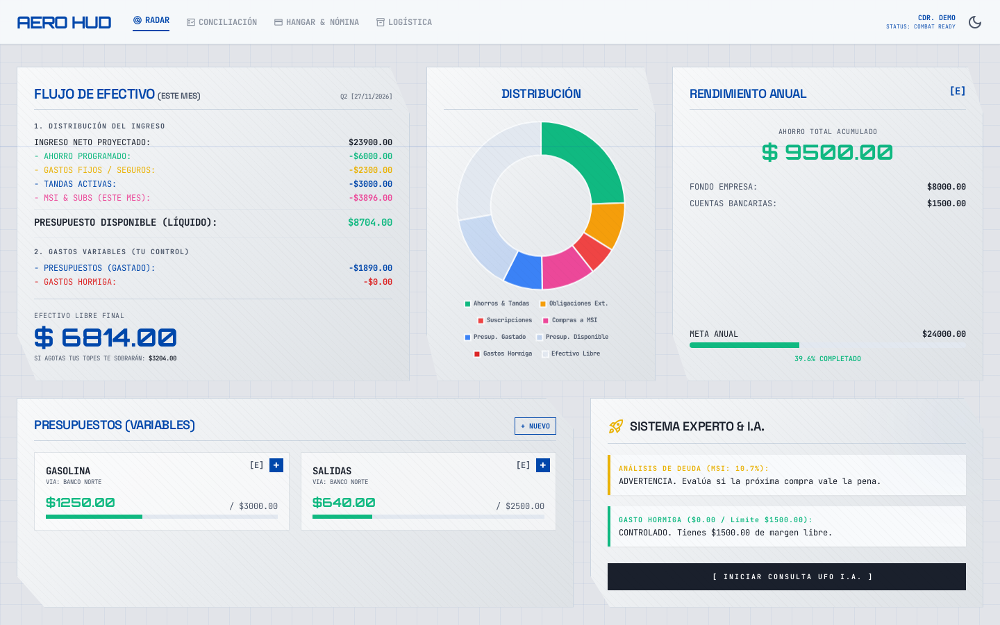
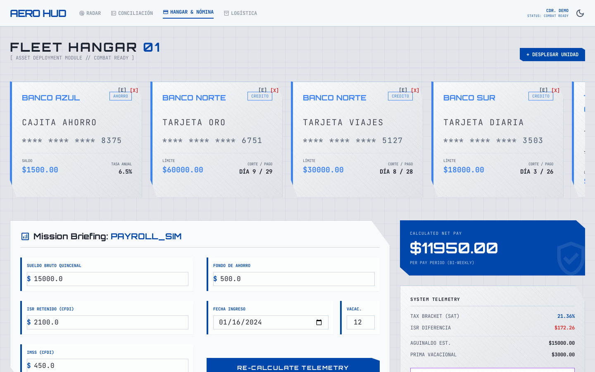
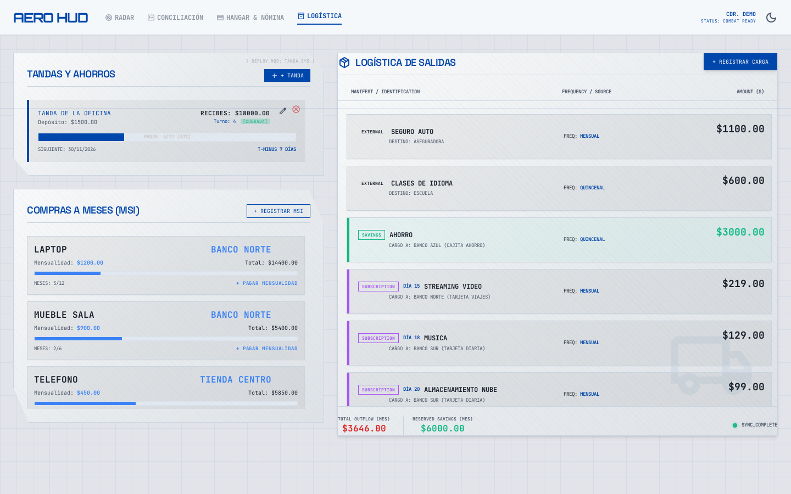
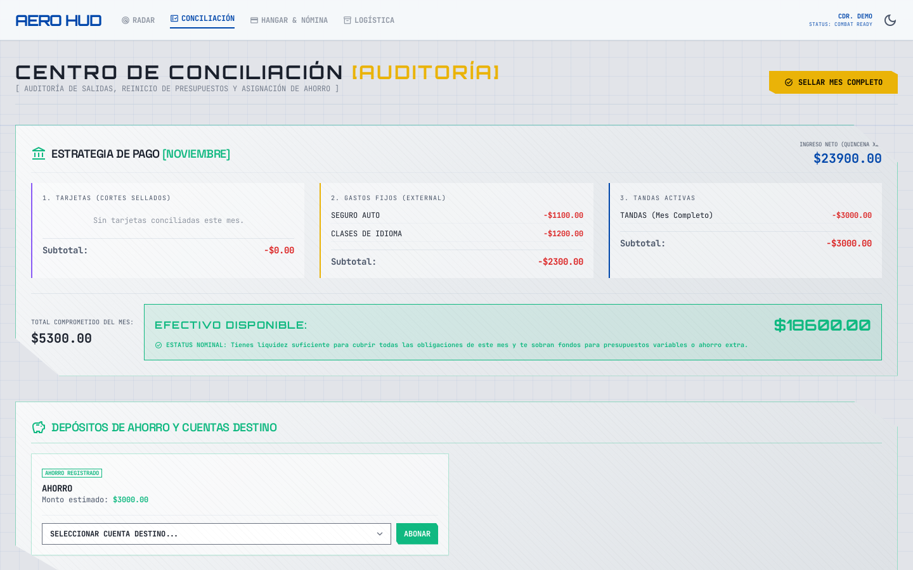

# AERO HUD

Panel de mando financiero personal con estética de cabina de aviación. Junta en un solo lugar la nómina, las tarjetas, las deudas a meses sin intereses (MSI), las tandas, las suscripciones y los presupuestos variables, y calcula cuánto efectivo libre queda cada mes.

Proyecto personal hecho con Flask. Los datos de la demostración son inventados.

> **English:** a personal finance dashboard built with Flask and SQLAlchemy. It projects monthly free cash from payroll, credit cards, installment plans (MSI), rotating savings groups (tandas) and budgets, and includes a payroll and income-tax simulator with a reverse calculator that recovers the gross bonus from the net deposit.

## Pantallas

| Radar (flujo de efectivo del mes) | Hangar (tarjetas y simulador de nómina) |
| --- | --- |
|  |  |

| Logística (tandas, MSI y cargas recurrentes) | Conciliación (cierre de mes) |
| --- | --- |
|  |  |

## Qué hace

- **Radar:** resume el mes. Ingreso neto proyectado, menos ahorro, gastos fijos, tandas y MSI, igual a presupuesto disponible; gráfica de distribución, rendimiento anual contra una meta y presupuestos variables con botón para registrar cada gasto.
- **Hangar y nómina:** administra cuentas y tarjetas (límite, día de corte, día de pago, tasa) y simula la nómina: ISR retenido contra el cálculo con la tabla del SAT, aguinaldo, prima vacacional y fondo de ahorro.
- **Logística:** tandas con su avance y su turno, compras a MSI con pago mensual, y cargas recurrentes (seguros, suscripciones, ahorro) ligadas a la tarjeta de la que salen.
- **Conciliación:** cierre mensual. Audita las salidas del mes, reinicia presupuestos y asigna el ahorro a una cuenta destino.
- **Sistema experto:** reglas simples que avisan de deuda por MSI y de gasto hormiga. El botón de consulta con IA es un marcador de posición para una integración futura.

## Cómo calcula

- **ISR quincenal:** aplica la tarifa del SAT 2026 por tramos (límite inferior, cuota fija y porcentaje sobre el excedente) en `app/utils.py`, y la compara con el ISR que trae el recibo (CFDI) para mostrar la diferencia.
- **Aguinaldo y prima vacacional:** salario diario por 15 días de aguinaldo y 25 % de prima sobre los días de vacaciones.
- **Fondo de ahorro:** ciclo anual que arranca el 16 de julio, con 24 quincenas y aportación del empleado igualada al 100 %.
- **Calculadora inversa:** a partir del depósito que cayó al banco, encuentra el bono bruto que lo produce con una búsqueda binaria sobre el cálculo del ISR (100 iteraciones, precisión al centavo). Sirve para descifrar un recibo cuando solo conoces el neto.

Las tablas de impuestos son una referencia personal, no asesoría fiscal. Verifica los tramos vigentes en el SAT antes de usarlas.

## Arquitectura

```
Flask (app factory)
 ├── radar      resumen del mes, presupuestos, conciliación
 ├── hangar     cuentas, tarjetas y simulador de nómina
 ├── logistics  tandas, MSI y cargas recurrentes
 └── payroll    cálculo de nómina e ISR
SQLAlchemy + SQLite  ·  Jinja2 + Tailwind + Chart.js
```

Cada módulo es un blueprint de Flask con sus rutas y plantillas. El modelo de datos (`app/models.py`) tiene 8 tablas: perfil de usuario, unidades del hangar, cargas recurrentes, tandas, compras MSI, presupuestos variables, gastos de presupuesto y gastos de tarjeta.

## Cómo correrlo

```bash
python -m venv venv
source venv/bin/activate        # en Windows: venv\Scripts\activate
pip install -r requirements.txt
python seed_demo.py             # carga datos de demostración
python run.py                   # http://localhost:8888
```

Variables opcionales: `SECRET_KEY`, `DATABASE_URL`, `PORT` y `FLASK_DEBUG=1`.

Sin `seed_demo.py` la base arranca vacía y puedes capturar tus propios datos desde la interfaz. La base local no se sube al repositorio.

## Ideas para seguir

- Conectar el botón de IA a un modelo para dar recomendaciones sobre el flujo del mes.
- Importar movimientos desde el estado de cuenta en PDF o CSV.
- Alertas de fechas de corte y pago.
- Pruebas automáticas de los cálculos de ISR y MSI.

## Stack

Python, Flask, SQLAlchemy, SQLite, Jinja2, Tailwind CSS, Chart.js.
